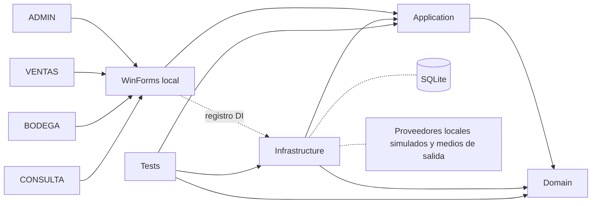
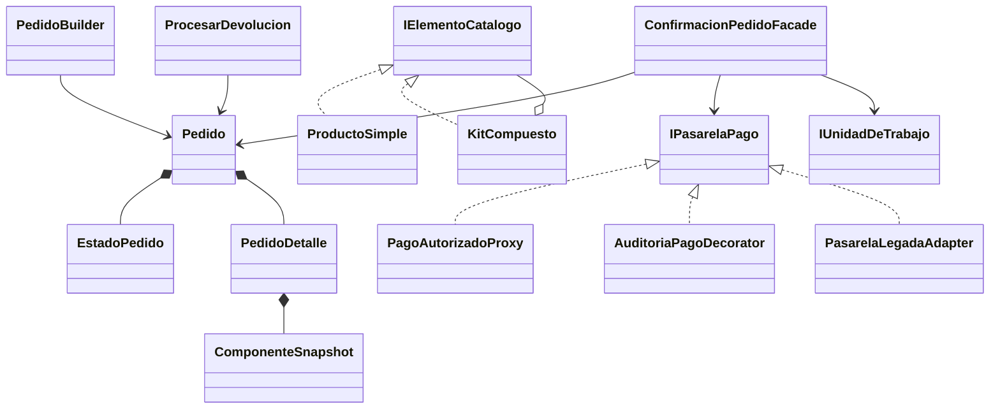
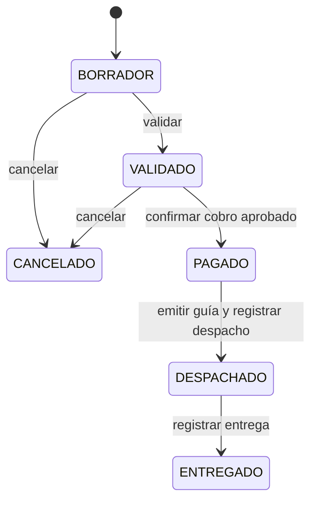
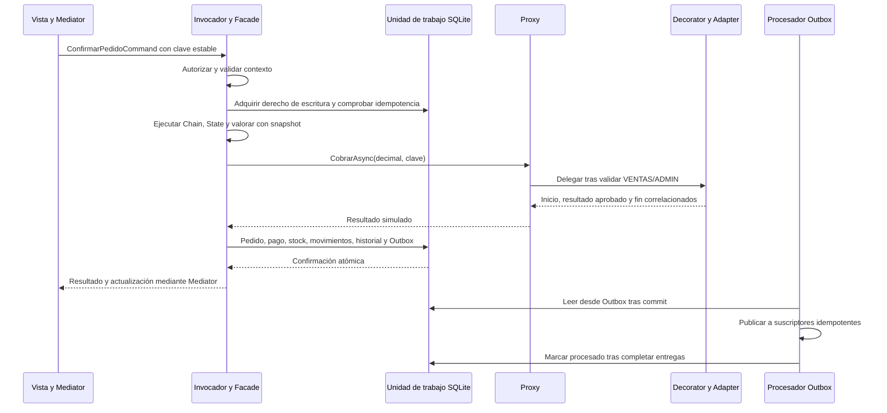
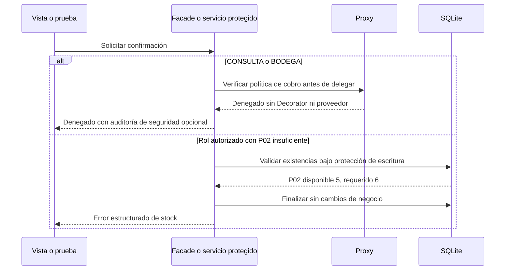

# Diseño técnico preliminar

Diagramas y nombres propuestos para orientar la implementación. La matriz de evidencia citará nombres definitivos y métodos existentes tras cada incremento.

## Contexto y componentes

Las flechas a proyectos indican referencias. WinForms recibe casos de uso y DTO mediante DI. Solo el punto de composición referencia el registro de Infrastructure. Domain y Application carecen de SQL, EF, SQLite y UI. Domain mantiene invariantes y operaciones del agregado sin setters públicos que las omitan. Application separa comandos de consultas, aplica permisos y valida, usa puertos segregados para repositorios, unidad de trabajo, pasarela, reloj, publicación y salida. Infrastructure implementa Repository con EF Core 8, DbContext y transacción como Unit of Work, migraciones, simuladores y Outbox. Tests usa xUnit y referencias a las tres capas no visuales. Mediator y vistas se prueban con un contrato de coordinación comprobable sin una referencia prohibida de Tests a WinForms, más comprobación visual P28.

## Clases críticas y estado

La devolución crea un registro vinculado al ENTREGADO, con transición operativa propia e historial. Repeticiones y transiciones inválidas se rechazan mediante objetos de estado. El reintento idempotente de confirmación devuelve el resultado persistido sin volver a ejecutar la transición.

## Modelo relacional mínimo ampliado

| Tabla | Identidad, relaciones y restricciones propuestas |
| --- | --- |
| Usuario | PK, identificador local único, hash con sal y rol válido. |
| Cliente | PK e identificación buscable, nombre, contacto, categoría y condición activa. |
| Producto | PK, SKU único, precio positivo, peso no negativo, stock entero ≥ 0 y control de concurrencia. |
| Kit | PK, SKU/sigla de kit única, nombre y composición. Impedir colisión de códigos con el catálogo físico mediante la política de catálogo y persistencia consistente. |
| KitComponente | PK y FK a Kit padre; FK a Producto o Kit hijo, exactamente una; cantidad positiva; ciclo comprobado al guardar el grafo. |
| Pedido | PK, FK a Cliente, estado, forma de entrega, tiempos y datos de valoración. Índices en cliente, estado y fecha. |
| PedidoDetalle | PK, FK a Pedido, identidad de artículo y snapshot de precio/cantidad; preservar identidad histórica al retirar artículos. |
| PedidoDetalleComponente | PK, FK a PedidoDetalle, SKU y cantidades expandidas del snapshot; conservar precios, pesos y estructura necesarios para trazabilidad. |
| Pago | PK, FK a Pedido única, referencia de cobro única, clave de idempotencia única, proveedor e importe persistidos. |
| MovimientoInventario | PK, FK a Producto, motivo, referencia y cantidad con signo. Identidad de la operación/sku para impedir duplicados. |
| Despacho | PK, FK única a Pedido, guía simulada, plazo y fechas de despacho/entrega. |
| Devolucion | PK, FK única a Pedido, motivo, condición, fecha, reintegro, importe y referencia de reembolso única. |
| EventoOutbox | PK de evento, identificación de agregado/operación, tipo, carga, estado, intentos y marcas temporales. Índice estado/fecha. |
| Auditoria | PK, actor cuando aplique, fecha, categoría, resultado, correlación y referencia. Trazas de pago y seguridad distinguibles. |
| HistorialPedido | PK, FK a Pedido, estados anterior/nuevo, actor, fecha y referencia. |
| EntregaEvento | PK compuesta evento/suscriptor o clave equivalente para aplicar efectos durables idempotentes. |

Usar PK/FK reales, índices de búsqueda, restricciones y pruebas SQLite. El valor monetario del núcleo será decimal; evaluar en la primera migración la persistencia exacta en centavos enteros para totales y comparaciones SQLite, manteniendo la tarifa y las reglas oficiales. Guardar snapshots separados del catálogo actual y calcular cobro/devolución de pedidos ya registrados con esos datos. Revisar la baja de productos vinculados como baja lógica para preservar FK e historial, con búsqueda apropiada.

## Secuencia de confirmación aprobada

## Secuencia de operación rechazada

El Proxy también se invoca y prueba directamente desde Application sin UI. Si la autorización se evalúa al entrar a la fachada, debe reutilizar la misma política que protege la pasarela y denegar antes de cualquier traza de cobro. Un fallo simulado autorizado sí produce INICIO y ERROR/FIN según corresponda, pero no Outbox de éxito.

## Integridad, acceso y consultas

- **Concurrencia e idempotencia.** Diseñar la confirmación con escritura SQLite serializada o control equivalente, comprobando de nuevo pedido, clave y existencias antes de invocar al proveedor. P36 exige máximo un cobro aprobado con stock uno: un conflicto optimista detectado solo después de invocar ambos proveedores sería insuficiente. Acotar el manejo de bloqueo y reabrir la transacción si se reintenta. Misma clave y pedido recuperan el resultado original. Reutilizar clave en otro pedido se rechaza. Usar simuladores locales idempotentes con referencia estable por solicitud y sin efectos externos irreversibles; probar fallo tras pasarela y antes de commit. Definir el comportamiento de reintento de un fallo rechazado sin confundirlo con un cobro aprobado.
- **Outbox.** Eventos PedidoPagado, DespachoRegistrado y DevolucionAceptada se guardan en la transacción de negocio que corresponda. Al publicar, cada suscriptor registra su identidad de procesamiento y reintenta pendientes; una falla parcial no debe duplicar el aviso ni la auditoría. Para avisos simulados usar un registro local idempotente, y para métricas de sesión deduplicar por evento y sincronizar incrementos; SQLite conserva la fuente durable. Correlacionar evento, pedido e intentos. Las trazas diagnósticas de cobro deben poder observarse aun ante rollback del negocio.
- **Devolución.** Reloj inyectable y fechas consistentes, transacción de devolución/reembolso simulado/stock/Outbox, reintegro por SKU históricos y unicidad por pedido. Probar día 7/8 y día 30/31; verificar condición y motivo. Confirmar con el docente cómo interpretar «cuando proceda» para condiciones fuera del caso oficial y si los plazos son días calendario; propuesta inicial de días calendario inclusivos y reintegro de toda devolución aceptada en los casos de la guía.
- **Autenticación y consultas.** Derivar un hash con sal aleatoria y verificación local, nunca persistir contraseñas en claro. Seed idempotente que inserta faltantes sin restablecer operaciones; reinicio de prueba explícito sobre fixtures, con base de demostración separada de uso normal. AST restringido con AND antes que OR, paréntesis y valores tipados; aplicar expresiones o parámetros seguros sin SQL concatenado. Definir comillas para nombres con espacios, formato numérico de entrada y mensajes por posición.
- **Otros supuestos.** Mantener edición en BORRADOR y conservar snapshots por línea cuando se registra; acordar el tratamiento de cambios de composición tras una edición explícita y los umbrales de alerta de stock. La guía no fija esos umbrales ni credenciales productivas. Entrega se calcula y se muestra a partir de la familia elegida. Preparación logística se expresa mediante la vista y sus operaciones sin añadir estados oficiales.

## Decisiones implementadas en fase 1

- `ProductoSimple` y `KitCompuesto` implementan `IElementoCatalogo`. Cada enlace de `KitComponente` usa exactamente una FK hacia producto o kit hijo. Los disparadores de la migración protegen la unicidad de SKU entre ambas tablas y rechazan ciclos al insertar o actualizar enlaces. Si una migración futura reconstruye esas tablas, debe recrear los disparadores y reejecutar sus pruebas.
- `PedidoDetalleComponente` conserva los nodos como filas con una ruta y cantidades locales y acumuladas. La instantánea preserva el precio, peso y composición desde el registro de la línea. `EstadoDelPedido` define las transiciones y `HistorialPedido` las registra con actor y secuencia.
- En esta fase se conserva el `decimal` del dominio como texto numérico exacto en SQLite. Las restricciones comprueban el signo y el formato. Se pospuso la alternativa de centavos enteros para admitir precios positivos con más precisión. Los reportes deberán verificar comparaciones numéricas con esa representación. [Limitaciones del proveedor SQLite de EF Core](https://learn.microsoft.com/en-us/ef/core/providers/sqlite/limitations)
- `AgregarPersistenciaLogiMarket` registra los repositorios y DbContext por ámbito. `UnidadDeTrabajoSqlite` expone una transacción real. Un token GUID en Producto, Kit y Pedido detecta escrituras obsoletas. Las pruebas comprobaron conflictos de inventario y rollback de stock, movimientos y Outbox. El cobro completo deberá comprobar existencias dentro de la transacción antes de invocar al proveedor.
- `DatosIniciales` aplica la migración y añade únicamente datos faltantes en una transacción. `Pbkdf2HashClave` usa SHA-256 con sal aleatoria y comparación en tiempo constante. Ejecutar una sola instancia para la primera migración. [API PBKDF2 de .NET](https://learn.microsoft.com/en-us/dotnet/api/system.security.cryptography.rfc2898derivebytes.pbkdf2)
- Pago, despacho, devolución, auditoría, Outbox y entregas por suscriptor tienen esquema y restricciones. La autorización por caso de uso, el cálculo de importes y el procesamiento de eventos se incorporarán con los flujos completos.

## Núcleo comercial implementado en fase 2

- Application autentica mediante `IConsultaUsuarios` e `IHashClave`. El host conserva la identidad local; cada acción abre un ámbito de DI. `AutorizacionOperaciones` protege los servicios. El cobro vuelve a comprobar permisos en el Proxy, antes del Decorator y del proveedor simulado.
- `ConfirmacionPedidoFacade` verifica la clave y las existencias dentro de una transacción SQLite. El primer cobro de una unidad simultáneamente solicitada deja al competidor sin stock antes de invocar su proveedor. Pedido, pago, movimientos y evento pendiente se guardan juntos. Los diagnósticos del proveedor y las denegaciones bufferizadas se guardan después de terminar la transacción, por lo que un rollback no las elimina.
- `ValorarPedido` comparte cálculo entre cotización y confirmación. Solo una Strategy se aplica por prioridad. El descuento y el importe de cobro se redondean con `MidpointRounding.AwayFromZero`; el precio de la instantánea conserva su precisión. Se devuelve lo cobrado por productos menos descuento, sin flete.
- `DespacharPedidos` crea guía y plazo juntos con la Abstract Factory. Las devoluciones cuentan días calendario UTC, inclusivos, y verifican la condición sin uso para arrepentimiento. Las devoluciones totales elegibles reintegran una vez las unidades del snapshot. El reembolso simulado conserva una referencia única vinculada al pago.
- `ReprocesarEventos` es una operación ADMIN. El procesador toma eventos ya confirmados en lotes de hasta 100. Cada observador durable registra su efecto local y su marcador en la misma transacción. Si un observador falla, la entrada queda pendiente con intento y error. Un reintento conserva los efectos previos cuyo marcador se confirmó. Las métricas se deduplican por evento en memoria durante el host y no sustituyen el historial durable.
- El diagnóstico de cobro y la auditoría de comandos se escriben fuera de la transacción de negocio. Si ese guardado independiente falla después del commit, consultar el pedido o reintentar con la misma clave antes de repetir un cobro. El programa todavía carece de un panel dedicado para supervisar fallos de almacenamiento.

## Patrones integrados en fase 3

- **Borradores.** `Pedido.ClonarComoBorrador` preserva la instantánea, no vuelve a consultar la composición vigente y asigna identidades nuevas para pedido, líneas y componentes. `Pedido.BorradorMemento` captura modalidad de entrega y líneas completas. `HistorialBorrador` administra cinco estados incluyendo el actual, descarta rehacer después de una edición y coteja usuario y versión. La restauración crea nuevas identidades internas de detalle, deja intacto el historial de transiciones y nunca opera sobre pagos o movimientos. Si otro proceso cambia la versión, el historial local deja de ser aplicable.
- **Catálogo.** Iterator construye un recorrido en profundidad y con orden ordinal sobre la instantánea protegida por Composite. Visitor hace doble despacho sobre las entidades y mantiene una ruta de visita para evitar ciclos. El flyweight vive solo durante una proyección. Una edición posterior de metadatos no muta objetos ya presentados.
- **Pedidos y comprobantes.** Infrastructure obtiene una proyección tipada mediante EF Core. Application aplica el AST sobre estados, cliente y montos persistidos, por lo que la sintaxis no llega a SQL. Esta evaluación en memoria es adecuada para la base académica. La paginación o evaluación compatible con SQLite se reconsiderará si aumenta el volumen. Bridge compone una abstracción de venta o devolución con una salida elegida en el panel. El texto excluye cualquier validez tributaria.
- **Mediación.** `FormularioPrincipalMediator` despacha a cinco puertos de vista registrados. WinForms traduce la operación terminada a un cambio, abre ámbitos de lectura por vista y presenta los resultados. Una actualización fallida no cancela las demás ni revierte la venta. El panel inicializa un coordinador por ventana y deja los contratos disponibles para separar vistas más adelante.
- **Modelo.** Las funciones nuevas usan las tablas existentes. `HasPendingModelChanges` y la CLI de EF verificaron que la migración inicial sigue representando el esquema.
